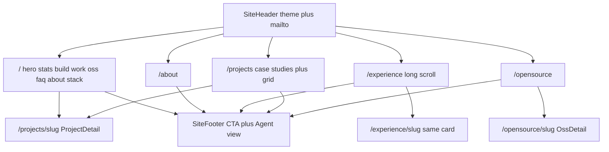

# Portfolio Redesign Implementation Plan

> **For agentic workers:** REQUIRED SUB-SKILL: Use superpowers:subagent-driven-development (recommended) or superpowers:executing-plans to implement this plan task-by-task. Steps use checkbox (`- [ ]`) syntax for tracking.
>
> Branch: `redesign/portfolio` (from `origin/main`).
> Visual spec: `design/Siddharth's Website Redesign/` (layout only).
> Content spec: live `src/data/*` and existing pages. **Do not import `site-data.js`.**

**Goal:** Restyle the live site to match the design canvases. Layout, type, color, and interaction come from the canvases. Words, sections, slugs, and SEO URLs come from the current site.

**Architecture:** Canvases are visual examples only. Typed modules in [src/data/](../../../src/data/) plus existing page copy are the only content source. Do not import or copy prose from [design/Siddharth's Website Redesign/site-data.js](../../../design/Siddharth's%20Website%20Redesign/site-data.js). Port chrome into new Astro components. No React. Small vanilla scripts for theme, filters, FAQ, role rotator, mobile menu.

**Tech Stack:** Astro 4, TypeScript, Tailwind 3, CSS variables, existing `src/data/*` + `src/utils/seo.ts` + `src/utils/llms.ts`.

**Visual spec (layout only):**
- Home: [design/Siddharth's Website Redesign/AI Portfolio.dc.html](../../../design/Siddharth's%20Website%20Redesign/AI%20Portfolio.dc.html)
- Chrome: [SiteHeader.dc.html](../../../design/Siddharth's%20Website%20Redesign/SiteHeader.dc.html), [SiteFooter.dc.html](../../../design/Siddharth's%20Website%20Redesign/SiteFooter.dc.html)
- Pages: [About.dc.html](../../../design/Siddharth's%20Website%20Redesign/About.dc.html), [Experience.dc.html](../../../design/Siddharth's%20Website%20Redesign/Experience.dc.html), [Work.dc.html](../../../design/Siddharth's%20Website%20Redesign/Work.dc.html), [Open Source.dc.html](../../../design/Siddharth's%20Website%20Redesign/Open%20Source.dc.html)

**Content spec (live site):** [src/data/products.ts](../../../src/data/products.ts), [opensource.ts](../../../src/data/opensource.ts), [experience.ts](../../../src/data/experience.ts), [about.ts](../../../src/data/about.ts), [caseStudies.ts](../../../src/data/caseStudies.ts), [domains.ts](../../../src/data/domains.ts), [highlights.ts](../../../src/data/highlights.ts), [awards.ts](../../../src/data/awards.ts), [philosophy.ts](../../../src/data/philosophy.ts), plus in-page copy already on [src/pages/](../../../src/pages/) and [src/components/](../../../src/components/).

## Hard rule: design vs content

If a canvas and the live site disagree, **live content wins**. If the canvas omits a live section, **keep the live section** and restyle it. If the canvas invents copy that is not on the live site (older bio, stub project details, canvas `whatIDo` cards), **do not use it**.

Additive UI that has no live equivalent is allowed only when it does not replace live copy: theme toggle, work filter chrome, FAQ accordion whose answers are assembled from live data, Agent-view modal over existing markdown.

## How new layouts are managed

New canvases are **shells**. Live `src/data/*` is **what goes in the shell**. We do not fork content. We build new Astro components that look like the canvas and take live objects as props.

Three cases:

1. **Same content, new layout** — wrap the live module in the new component. Example: `domains` become the “What I Build” cards; `products` fill the split Work cards; `aboutBio` fills the About background column.
2. **Canvas-only chrome** — add it, fill from live fields. Example: filter pills (categories in `workMeta.ts`), FAQ (answers built from experience/products/OSS/email), theme toggle, Agent-view modal over existing `.md` / `llms.txt`.
3. **Live section the canvas forgot** — keep it, restyle it in the same tokens (Figtree, cards, `--line`, amber). Example: About `aboutDepth` and `philosophyStats` sit under Technical expertise; OSS architecture/decisions sit under the new install hero; `/experience/[slug]` uses the same article card as the long-scroll index.

We never create parallel data. `site-data.js` is not imported. If a canvas widget needs a field the live type already has (`tagline`, `impact[0]`, `npmUrl`), read that field. If it needs a purely visual helper (filter tag `AI Agents`), that lives in a small additive map, not as a rewrite of `products.ts`.

Layout map (canvas region → live source → component):

- Pill header / theme / mailto → `site` URLs → `SiteHeader`
- Hero + intro tiles → `Hero.astro` H1/lede + `about.ts` → `HeroHome`
- Stats row → `highlights` + live 12+ badge → `StatsRow`
- What I Build → `domains` → `WhatIBuild`
- Filterable Work cards → `products` + `caseStudies` + `workMeta` categories → `WorkCard` + `WorkFilter`
- OSS cards + install strip → `openSourceProjects` + live npm/packagist → home OSS + `registry.ts`
- FAQ → live experience/products/OSS/email → `FaqSection`
- About page photo/background/journey → live `aboutBio`, `aboutCapabilities`, `aboutDepth`, `aboutSkills`, `philosophyStats`, `awards`, `experience` → restyled `about.astro`
- Experience long articles → live `experience` entries → `ExperienceArticle` on `/experience` and `/experience/[slug]`
- Work index (case studies + grid) → live `resolvedCaseStudies()` + `products` → `projects/index.astro`
- Project detail (metrics, PSO, architecture, decisions) → full live `Product` → `ProjectDetail`
- OSS detail (install hero **plus** live write-up) → full live `OpenSourceProject` → `OssDetail`
- Amber CTA + footer columns → live contact strings → `CtaBanner` + `SiteFooter`

## SEO URLs that must keep returning 200

Do not rename, redirect away, or drop any of these. Nav labels may change; hrefs may not.

- `/`, `/about` (profile OG), `/experience`, `/experience/apra-labs`, `/experience/mildlyclassic`, `/experience/uxgage`, `/experience/earlier`
- `/projects`, `/projects/graphrag`, `/projects/multi-agent`, `/projects/code-review`, `/projects/cloud-cost`, `/projects/infra-perf`, `/projects/search-sync`, `/projects/logistics-erp`, `/projects/uxgage`
- `/opensource`, `/opensource/apra-agent-kit`, `/opensource/plug`, `/opensource/codehawk`, `/opensource/php-zxing`, `/opensource/moo-pin`
- `/resume`, `/resume-print` (stay `noindex`, stay off the header)
- `/projects.md`, `/opensource.md`, `/experience.md`, every `/projects/[slug].md`, `/opensource/[slug].md`, `/experience/[slug].md`
- `/llms.txt`, `/llms-full.txt`
- Profile image `/images/profile.jpg` and architecture SVGs under `/images/architecture/`

Nav: **Work** → `/projects`. Never create `/work` or `/open-source`. Writing still goes to `site.medium`.

## Content-gap inventory (completed)

Compared live pages + `src/data/` against the AI Portfolio / About / Experience / Work / Open Source canvases. **Keep live.** Restyle into the new layout.

### Home `/`

Live today: Hero (H1, lede, profile.jpg, GitHub/LinkedIn, 12+ badge) → 4 `highlights` → 4 `domains` → 3 case studies (problem, constraint, approach, key decision, metric, `/projects/[slug]`) → 3 experience rows (`/experience/[slug]`) → 2 OSS cards (`/opensource/[slug]`) → contact (mailto + Medium/LinkedIn/GitHub) + `personJsonLd` / `websiteJsonLd`.

Canvas adds filters, FAQ, about teaser, stack, all-8 work cards, all-5 OSS. Those are extra chrome. Do not drop live case-study facts, live experience permalinks, or contact socials.

Gaps if we followed the canvas blindly:
- Home currently links experience to `/experience/[slug]`; canvas journey uses hashes — **keep slug URLs**
- Live hero GitHub/LinkedIn links — keep (header/footer also cover them)

### About `/about` (profile OG)

Live sections the About canvas does **not** have:
- Role line `Architect · Applied AI · Engineering Leader` (canvas overlay says “AI Architect”)
- Live lede (“working directly with the people who use them”)
- `aboutBio` paragraph 1 (client-interface / with the people who use it) and paragraph 5 (**forward deployed engineering**) — canvas bio is an older 4-paragraph extract and calls the title Associate Architect
- `aboutCapabilities`: Start from the problem, Architect and build, Ship and operate, Hire and enable — canvas “What I do” is a different four-card set. **Use live capabilities.**
- `aboutDepth`: 11 evidence rows (Distributed systems through Infrastructure & delivery)
- `philosophyStats`: 0→1 / 3 clients / 20+ engineers
- Fourth award **Best Boy Award** exists in `src/data/awards.ts`; About currently shows first 3. Keep at least those 3.

### Experience

Live `/experience` lists all roles and links each to a slug page. Canvas is one long scroll with hashes only.

Must keep slug pages and their live fields:
- `/experience/apra-labs` — metrics, What I shipped, Leadership & Impact
- `/experience/mildlyclassic` — metrics, What I shipped, Leadership & Process, Wifi Dabba extra
- `/experience/uxgage` — metrics, What I shipped, Leadership
- `/experience/earlier` — Firaa.me, Samvit Learning, dotCORD (dedicated URL, not only `#earlier`)
- JSON-LD collection + per-entry, `/experience.md` and `/experience/[slug].md`

### Work `/projects` + 8 details

Live `/projects` is titled **Case Studies** in `<title>` and JSON-LD breadcrumbs. Keep those strings for SEO even if the nav says Work.

Canvas Work detail is full only for GraphRAG and Multi-Agent. `site-data.js` has `detail: null` for cloud-cost, code-review, infra-perf, search-sync, logistics-erp, uxgage. **Live `products.ts` has full write-ups for all eight.** Required on every slug:
- Always: title, subtitle, tagline, stack, overview problem/solution/outcome, impact, howItWorks, decisions, reflections, company/confidential note
- Architecture SVG + fullscreen where live has it: GraphRAG, Multi-Agent, Cloud Cost, Infra Perf
- Evaluation where live has it: GraphRAG, Multi-Agent, Cloud Cost, Infra Perf
- Context/constraints where live has them
- `SplitDetailPage` contact block is replaced by SiteFooter; mailto/socials must still exist there

### Open Source `/opensource` + 5 details

Canvas detail is title, install, desc, tags, prev/next. Live detail for every OSS project also has overview, stats, howItWorks, decisions, reflections, and usually architecture + evaluation.

Extra live links the canvas omits — keep as buttons:
- Apra Agent Kit: npm, architecture SVG, evaluation
- Plug: npm, vault URL, architecture SVG, evaluation
- CodeHawk: Docker Hub, architecture SVG, evaluation
- PHP ZXing: Packagist, live stat **277K+ installs** (not canvas 282K+)
- MooPin: demo URL, architecture SVG, evaluation

### SEO / machine surfaces (no visual canvas)

Keep generating from live data, not from `site-data.js`: `/llms.txt`, `/llms-full.txt`, all `.md` indexes and slugs, JSON-LD, canonicals, `rel=alternate` markdown, sitemap, GA, CNAME, resume `noindex`.

### Additive from design (allowed; does not replace live copy)

Theme toggle, work filter pills, FAQ accordion (answers from live data), Agent-view markdown modal, darker metric panels, rotating role in the hero if it uses live titles.

## Global Constraints

- Light + dark via `html[data-theme]` and `localStorage` key `sd-ai-theme`. FOUC script in `<head>`.
- Palette and type from the canvases. No emoji in content. Theme icons ☀/☾ are allowed.
- Do not implement Claude chat / `window.claude.complete`.
- Footer View Resume opens `site.resumePath` PDF. Keep `/resume` and `/resume-print`.
- Every page reflows at 375px and 1280px. Header mobile breakpoint is **860px**.
- Verification: `npm run build` plus browser pass of pages the task touched. Content-parity: grep/read the live data module and confirm each field still renders.

## File map

Create:
- `src/styles/tokens.css` — light/dark CSS variables
- `src/styles/site.css` — redesign layout (replaces `src/styles/template.css`)
- `src/components/SiteHeader.astro`
- `src/components/SiteFooter.astro`
- `src/components/ThemeScript.astro`
- `src/components/CtaBanner.astro`
- `src/components/home/HeroHome.astro`
- `src/components/home/StatsRow.astro`
- `src/components/home/WhatIBuild.astro` — rewrite in place or replace
- `src/components/home/WorkFilter.astro`
- `src/components/home/WorkCard.astro`
- `src/components/home/FaqSection.astro`
- `src/components/home/AboutTeaser.astro`
- `src/components/home/StackSection.astro`
- `src/components/ExperienceArticle.astro`
- `src/components/ProjectDetail.astro`
- `src/components/OssDetail.astro`
- `src/data/faq.ts`
- `src/data/hero.ts`
- `src/data/workMeta.ts`
- `src/utils/workFilter.ts`
- `src/utils/registry.ts`

Modify:
- `tailwind.config.mjs`, `src/styles/global.css`, `src/layouts/BaseLayout.astro`
- All HTML pages under `src/pages/`
- Data modules only for additive helpers (filter categories, FAQ assembled from live fields, registry install strings derived from existing npm/packagist URLs). Never rewrite or replace live prose.

Delete after the new pages render: `src/styles/template.css`, `src/components/Nav.astro`, old `Hero.astro`, `ImpactHighlights.astro`, `CaseStudiesSection.astro`, `ExperienceSection.astro`, `ExperienceRow.astro`, `ProductsSection.astro`, `ContactSection.astro`, `SplitDetailPage.astro`, unused `PhilosophySection.astro`, `RecognitionSection.astro`, icon wrappers.



---

### Task 1: Design tokens, fonts, theme bootstrap

**Files:**
- Create: `src/styles/tokens.css`, `src/components/ThemeScript.astro`
- Modify: `tailwind.config.mjs`, `src/styles/global.css`, `src/layouts/BaseLayout.astro`

**Tokens (copy exactly):**
- Light: `--bg:#F7F5F0; --ink:#15140F; --soft:#45423B; --muted:#77736A; --line:#E3DED3; --card:#FFFFFF; --card2:#EFEBE2; --acc:#94570A; --glass:rgba(247,245,240,0.85); --amber:#F5A623`
- Dark (`html[data-theme="dark"]`): `--bg:#0E0E0D; --ink:#EDEBE6; --soft:#B9B5AC; --muted:#8F8B83; --line:#262521; --card:#161614; --card2:#1E1D1A; --acc:#F5A623; --glass:rgba(14,14,13,0.85)`
- Fonts: Figtree (sans 400–800), Newsreader italic (display), IBM Plex Mono (12px labels)
- Tailwind: `sans` → Figtree, `display` → Newsreader, `mono` → IBM Plex Mono; map `bg`/`ink`/`soft`/`muted`/`line`/`card`/`card2`/`acc`/`amber` to the CSS vars; `maxWidth.content` → `1180px`

**ThemeScript:** inline in `<head>` before paint:

```js
(function () {
  try {
    var t = localStorage.getItem('sd-ai-theme');
    if (t === 'dark' || t === 'light') document.documentElement.setAttribute('data-theme', t);
  } catch (e) {}
})();
```

Toggle writes the same key and flips `data-theme`. `theme-color` meta: light `#F7F5F0`, dark `#0E0E0D` (or keep `#F5A623` if you prefer the existing amber chrome — default to canvas bg).

- [ ] Land tokens + fonts + FOUC script; body uses `bg-[var(--bg)] text-[var(--ink)] font-sans`
- [ ] Toggle in a temporary button on `index.astro` to prove light/dark persist across reload
- [ ] `npm run build` passes
- [ ] Commit: `style: add redesign tokens, fonts, and theme bootstrap`

---

### Task 2: Additive helpers only (no live-copy edits)

**Files:**
- Create: `src/data/hero.ts`, `src/data/faq.ts`, `src/data/workMeta.ts`, `src/utils/workFilter.ts`, `src/utils/registry.ts`
- Do **not** rewrite `src/data/products.ts`, `about.ts`, `experience.ts`, or OSS prose.

**hero.ts** — only live strings:
- H1 from current `src/components/Hero.astro`: `Production AI systems for complex, real-world problems.`
- Lede from that same hero.
- Role rotator starts with live About role: `Architect · Applied AI · Engineering Leader` (from `src/pages/about.astro`), then shorter live labels if needed. Do not use canvas “Associate Architect”.
- Intro tiles: live about lede, live hero lede, live “I own the outcome end to end.”

**highlights.ts:** keep the four live stats. The live hero already has “12+ years shipping” as a badge — reuse that string in the stats row if the layout wants five tiles. Do not invent new metrics.

**faq.ts:** FAQ is new chrome. Questions can follow the canvas list. **Answers must be assembled from live data** (`experience`, `resolvedCaseStudies()`, `openSourceProjects`, `aboutSkills`, `site.email`). No canvas-extracted sentences.

**workMeta.ts:** filter categories only (interaction). Card headline = live `product.tagline`. Description = live `product.description`. Metric = live `product.impact[0]`. Featured cases stay `src/data/caseStudies.ts`.

**workFilter.ts:**

```ts
export function matchesWorkFilter(
  product: { slug: string; categories: string[]; isCase: boolean },
  filter: string
): boolean
```

`All` → true; `Case Studies` → `isCase`; else `categories.includes(filter)`.

**registry.ts:** derive install/registry UI from live `npmUrl` / `packagist` / `url` already on `src/data/opensource.ts`. Live php-zxing copy already says `277K+ Packagist installs` — use that, not the canvas `282K+`.

- [ ] Helpers added; live data files unchanged except optional 12+ reuse from existing hero badge
- [ ] `npm run build` passes
- [ ] Commit: `feat: add filter, FAQ, and registry helpers from live data`

---

### Task 3: Shared header and footer

**Files:**
- Create: `src/components/SiteHeader.astro`, `src/components/SiteFooter.astro`, `src/components/CtaBanner.astro`, `src/styles/site.css` (header/footer/cta rules)
- Modify: `src/layouts/BaseLayout.astro` to render header/footer unless `hideChrome` (resume-print stays standalone)

**Header** (pixel-faithful to SiteHeader.dc.html):
- Fixed pill bar, `max-width: 1180px`, glass + blur, 44px targets
- Brand: amber `SD` disc + name (hide name below 1080px desktop / 360px)
- Nav: Home `/`, About `/about`, Experience `/experience`, Work `/projects`, Open Source `/opensource`, Writing ↗ `site.medium` (`target=_blank`)
- Active item: `background: var(--card2)`, weight 700; mobile active gets amber dot
- Theme button 44×44; desktop CTA `mailto:${site.email}` “Get in Touch”; `<860px` Menu/Close expands stacked links + amber mailto
- `active` prop: `'Home' | 'About' | 'Experience' | 'Work' | 'Open Source'`

**Footer** (SiteFooter.dc.html on every chrome page):
- Amber CTA: “Let’s build something *great.*” / “Always open to interesting problems and collaborations.” / Let’s Talk → mailto / View Resume → PDF
- Columns: SD mark + © line; Pages (same five internal links); Contact (email, LinkedIn, GitHub, Medium)
- Agent view button opens a modal: title “Agent view”, Copy Markdown, Close; body is the page’s markdown alternate if `markdownPath` is set, otherwise `/llms.txt` text. Copy uses `navigator.clipboard.writeText`

- [ ] Swap `Nav` for `SiteHeader` on `index` and `about` only first, visually match the canvas
- [ ] Browser: desktop nav, 375px menu, theme toggle, mailto, Writing external
- [ ] `npm run build`
- [ ] Commit: `feat: add shared SiteHeader, SiteFooter, and CTA banner`

---

### Task 4: Homepage

**Files:**
- Rewrite: `src/pages/index.astro`
- Create the `src/components/home/*` sections listed above
- Keep JSON-LD: `websiteJsonLd()`, `personJsonLd()`

**Section order (layout from AI Portfolio.dc.html, copy from live data):**
1. Hero — live profile.jpg, live H1/lede, live role line, intro tiles from live about/hero copy, CTAs to `#work`, `#ask`, resume PDF
2. Stats — live `highlights` (+ live “12+ years shipping” badge if a fifth tile is needed)
3. What I Build — live `src/data/domains.ts` (titles, problems, work, evidence links to `/projects/...`)
4. `#work` — filter chrome around live `products` + `resolvedCaseStudies()`. Headline = `tagline`, body = `description`, metric = `impact[0]`, stack = live `stack`/`tags`. Links: `/projects/[slug]`
5. `#oss` — all live `openSourceProjects` (5, including Apra Agent Kit). Links: `/opensource/[slug]` and live GitHub URLs
6. `#ask` — FAQ chrome, answers from live data
7. `#about` — live `aboutBio` (all paragraphs, FDE included), live `aboutCapabilities` (not canvas whatIDo), journey links to `/experience/[slug]` (SEO URLs, not only hashes), live awards
8. `#stack` — live `aboutSkills`
9. Shared `SiteFooter`

Work filter script as before. Product order stays the live `products` array order unless the canvas order is only a visual sort — prefer live array order.

- [ ] Every home card/link points at a live SEO URL
- [ ] No canvas-only copy on the page
- [ ] `npm run build` + browser pass
- [ ] Commit: `feat: restyle homepage; keep live content and project URLs`

---

### Task 5: About page

**Files:** Rewrite `src/pages/about.astro`. Keep `aboutPageJsonLd()`.

Layout from About.dc.html; **every live About section still renders**:
- Hero: live name, live role `Architect · Applied AI · Engineering Leader`, live about lede, profile.jpg, `ogType="profile"`
- Background: all live `aboutBio` paragraphs (HTML emphasis kept, including FDE)
- What I do: live `aboutCapabilities`, not canvas cards
- Technical depth: live `aboutDepth`
- Skills: live `aboutSkills`
- Stats: live `philosophyStats`
- Education: live `aboutEducation`
- Recognition: live `awards`
- Journey links (if shown) go to `/experience/apra-labs` etc., not `Experience.dc.html`
- Keep `aboutPageJsonLd()` and current about title/description unless they already match live copy

- [ ] Diff against current about.astro section list — nothing dropped
- [ ] Browser `/about` desktop + mobile
- [ ] `npm run build`
- [ ] Commit: `feat: restyle About; keep live bio, capabilities, and depth`

---

### Task 6: Experience index and slug pages

**Files:**
- Create: `src/components/ExperienceArticle.astro`
- Rewrite: `src/pages/experience/index.astro`, `src/pages/experience/[slug].astro`
- Keep markdown routes and JSON-LD

`/experience` long-scroll layout from the canvas, **copy from live `experience` entries** (role titles, periods, summaries, metrics, items, columns, extra notes, earlierEntries).

`/experience/[slug]` stays a real indexed page (not a client-only hash). Same live fields as today, restyled. Canonical, `markdownPath`, `experienceJsonLd`, breadcrumbs unchanged. Home/About may also hash-scroll the index, but slug URLs remain the SEO permalinks.

- [ ] `/experience`, `/experience/apra-labs`, `/experience/mildlyclassic`, `/experience/uxgage`, `/experience/earlier`, `/experience.md` all 200
- [ ] Each slug page still shows that entry’s full live content
- [ ] `npm run build` + browser
- [ ] Commit: `feat: restyle Experience; keep slug URLs and live role content`

---

### Task 7: Work index and project detail

**Files:**
- Create: `src/components/ProjectDetail.astro`
- Rewrite: `src/pages/projects/index.astro`, `src/pages/projects/[slug].astro`
- Replace `SplitDetailPage` usage

`/projects` layout from Work.dc.html. Cards read live `resolvedCaseStudies()` + `products` (title, tagline, description, company, impact, stack). Breadcrumb name in JSON-LD can stay “Case Studies” for SEO even if the nav says Work.

`/projects/[slug]` **must render the full live `SplitDetailPage` field set** from `src/data/products.ts`, restyled:
- title, subtitle, tagline, stack, confidentialNote / company
- context, constraints, overview.problem/solution/outcome, impact
- architectureSvg + existing fullscreen dialog
- howItWorks, decisions, evaluation, reflections
- canonical `/projects/[slug]`, `markdownPath`, `projectJsonLd`

Ignore canvas `detail: null` stubs. Cloud-cost, infra-perf, search-sync, logistics-erp, uxgage, code-review keep their live write-ups.

- [ ] All 8 slugs + `/projects.md` + each `.md` 200
- [ ] Spot-check GraphRAG and Cloud Cost still have architecture/decisions/evaluation
- [ ] `npm run build`
- [ ] Commit: `feat: restyle Work pages; keep full live project write-ups`

---

### Task 8: Open Source index and detail

**Files:**
- Create: `src/components/OssDetail.astro`
- Rewrite: `src/pages/opensource/index.astro`, `src/pages/opensource/[slug].astro`

Index layout from the canvas. Cards use live `openSourceProjects` (title, subtitle, description/tagline, tags, language, stats, GitHub). View More → `/opensource/[slug]`.

Detail: canvas install/clone card is extra chrome **on top of** the live write-up. `OssDetail` must still take the same props `src/pages/opensource/[slug].astro` already passes into `SplitDetailPage` (overview, stats, architectureSvg, howItWorks, decisions, evaluation, reflections, GitHub/npm/packagist/vault/docker/demo links). Do not ship a title-only OSS page.

- [ ] All 5 slugs + `/opensource.md` + each `.md` 200
- [ ] Plug and CodeHawk still show architecture/decisions
- [ ] `npm run build` + browser
- [ ] Commit: `feat: restyle Open Source; keep full live write-ups`

---

### Task 9: Wire remaining pages, SEO, and delete leftovers

**Files:** any remaining page still on `Nav` / old sections; delete unused components and `template.css`; drop its import from `BaseLayout`.

Must still work unchanged in behavior:
- `src/utils/seo.ts` JSON-LD on every HTML page
- `markdownPath` alternate links
- `src/pages/llms.txt.ts` / `llms-full.txt.ts`
- Sitemap exclude `/resume`, `.md`, `.txt`
- Resume pages stay `noindex`; not in the new header
- GA snippet stays in `BaseLayout`

- [ ] Grep for `template.css`, `Nav.astro`, `SplitDetailPage`, `ContactSection` — zero references
- [ ] `npm run build`
- [ ] Commit: `refactor: remove pre-redesign layout components`

---

### Task 10: URL, content-parity, then visual QA

Content-parity first (live data must still appear):
- Every slug in the SEO URL list above returns 200
- About still has capabilities, technical depth, philosophyStats, FDE paragraph
- GraphRAG / multi-agent / cloud-cost details still have architecture + decisions + evaluation from `products.ts`
- Plug / CodeHawk / php-zxing details still have live write-ups from `opensource.ts`
- No `*.dc.html` hrefs, no pasted `site-data.js` prose
- `/llms.txt`, `/projects/graphrag.md`, sitemap still generate from live data

Then visual (light and dark, 1280 and 375): home filters/FAQ/theme, About, Experience index+slug, Work index+detail, OSS index+detail, header/footer.

- [ ] URL crawl + content-parity pass
- [ ] Visual pass vs canvases
- [ ] Commit: `fix: redesign QA for URLs, live content, and theme`

## Out of scope

- New public routes (do not add `/work` or `/open-source`)
- Replacing live copy with canvas/`site-data.js` extracts
- Claude chat / `support.js`
- Resume in the header
- Deploy / merge to `main` until asked
